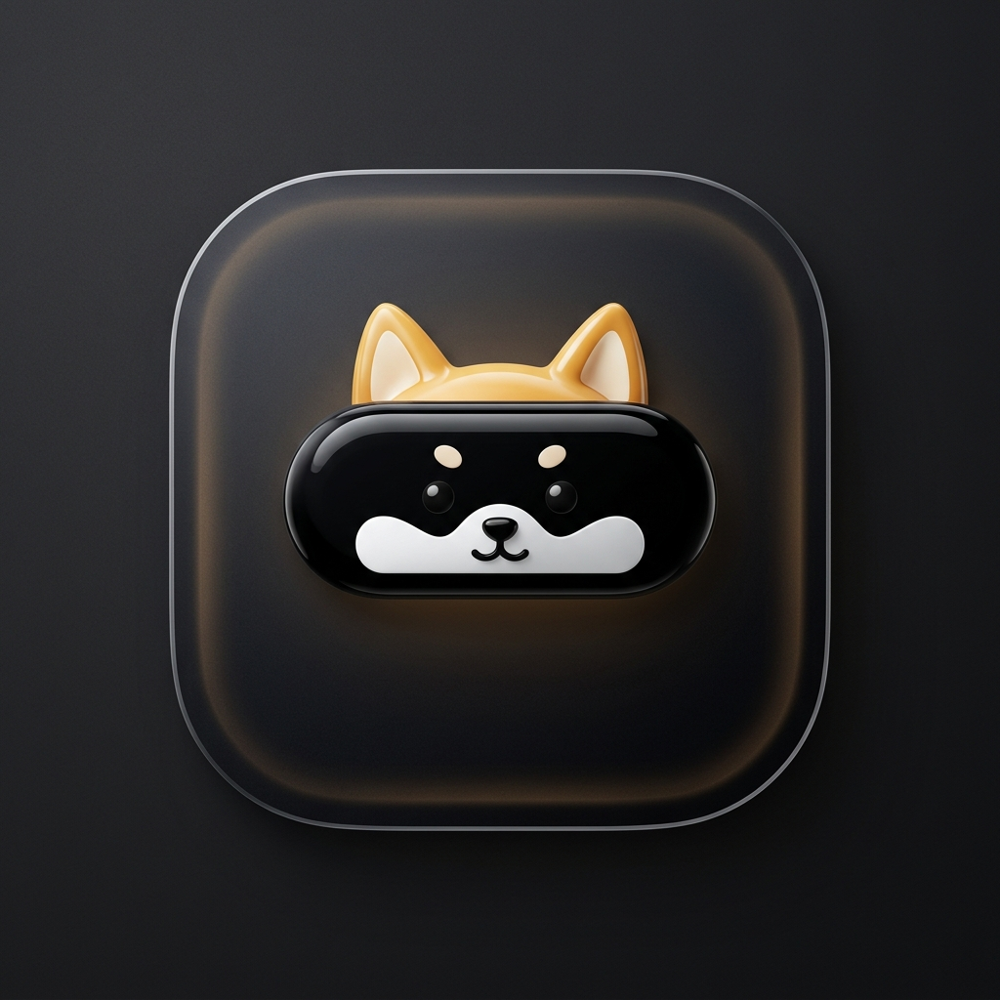

<p align="center">
  
</p>

# Isle — The Living Dynamic Island for Windows

<p align="center">
  <strong>An elegant, context-aware Apple Dynamic Island & desktop companion for Windows 10 & 11.</strong>
</p>

<p align="center">
  
  
  
  
  
  
  
</p>

---

## Overview

**Isle** brings the refined aesthetics and fluid, context-aware motion of Apple's Dynamic Island to Windows 10 and 11. Designed from the ground up as a native desktop companion, Isle mounts cleanly to the physical bezel of your display, adapting its shape, size, and expressions to system audio, CLI coding agents, hardware peripherals, focus timers, and system events.

---

## Feature Showcase

### 🐶 Shiba Notch Mascot
- **Procedural Companion**: Reactive animated Shiba companion that tracks cursor gaze in real time, executes natural procedural blinking intervals, and wiggles its ears to music.
- **ThinkPad F4 Hardware Mic Privacy**: Detects hardware microphone mute and overlays a clean white tape cross `( · 🗙 · )` over Shiba's mouth to visually guarantee zero audio leakage. Clicking the mascot or pressing `F4` instantly toggles mic state.
- **Emotion States**: Expresses contextual reactions for low battery (droopy ears), charging (sparkling eyes), happy praise (blushing cheeks), and zen focus.

### 🎵 Breathing Live Lyrics
- **Dynamic Breathing Pill**: When music plays and Isle is collapsed, the compact pill automatically resizes (`clamp(210px, textWidth + 84px, 480px)`) to hug the active lyric line using spring physics (`layout: true`).
- **LRCLIB Real-Time Synchronization**: Pulls synced LRC lyrics with automatic time matching, sliding outgoing lyrics up and fading in incoming lyrics from below.
- **Instrumental Break Detection**: Automatically contracts back to minimal resting width (~200px) during instrumental interludes (> 3.5s).
- **Karaoke Auto-Scroll & Scroll Isolation**: Expanding the Media tab provides a frosted glass lyrics pane with linear gradient fade masks. Scrolling inside the lyrics container is strictly trapped so it never triggers accidental tab flipping.

### 🛡️ Attention & Etiquette Engine
- **Fullscreen Auto-Hide**: Detects fullscreen games, media playback, and presentations to completely slide Isle off-screen, maintaining zero screen obstruction.
- **Deep Work Zen Mode**: Configurable quiet hours and Pomodoro linkage that transitions Shiba into peaceful meditation and silences ambient notifications.
- **Instant Do Not Disturb (DND)**: One-click moon button in the header suppresses non-critical popups and animations immediately.

### 📊 Consolidated 7-Tab Productivity Suite
Subtle white pagination dots sit quietly at the bottom of the card, expanding upon hover into a frosted glass dock:
1. 🎵 **Media (`Music2`)**: Fluid OS media controller, scrubber, volume slider, and side-by-side lyrics pane.
2. ⏱️ **Focus (`Timer`)**: 25/5 Pomodoro timer with automatic short/long break transitions and singing bowl chime.
3. 💧 **Hydration (`Droplets`)**: Water intake tracking with midnight auto-rollover and daily streak preservation.
4. 📝 **Tasks (`CheckSquare`)**: Quick categorized task checklist with priority badges and completed clearing.
5. 📁 **Shelf & Clipboard (`Folder`)**: Unified drag-and-drop file staging, scrcpy Android companion, and pinned clipboard history.
6. ⚡ **Hardware Monitor (`Activity`)**: Live CPU, GPU, memory, and telemetry indicators.
7. 🧘 **Zen Breathing (`Smile`)**: 4-4-4-4 Box Breathing visual guide for decompression.
*(plus quick access to ⚙️ **Settings**)*

### 🤖 Coding Agent Monitor (Mission Control HUD)
- **Authentic Brand Glyph**: Eliminates generic robot emojis in favor of the official **Anthropic Spark / Starburst logo** for Claude Code, Codex spiral for OpenAI, and clean Terminal icon for generic agents.
- **Real-Time HUD**: Real terminal actions (e.g., `Claude Code: Editing window.rs...`), interactive `Approve` / `Reject` buttons for CLI permissions, and pass/fail build toasts with instant terminal focus.

### 🎨 4-Theme Architecture
- **System Auto**: Dynamically tracks Windows system dark/light preference.
- **OLED Dark**: Obsidian glass silhouette tuned for deep black OLED displays.
- **Pearl Light**: Luminous frosted white glass tailored for daytime and light mode aesthetics.
- **Liquid Glass (Mica)**: Ultra-translucent glass with multi-pass real-time backdrop blur filtering. Includes a performance advisory badge in Settings:
  > ⚠️ *"Liquid Glass may slightly increase CPU, GPU, and RAM consumption due to multi-pass real-time backdrop blur filtering."*

### 📸 Screenshot PrtSc Engine
- **JSON Metadata Staging**: Captures `PrintScreen` events and stages path metadata to the Shelf store with zero duplicate file creation.
- **Privacy Toggle**: Configurable in Settings: *"Hide Isle during Screenshots (PrtSc)"* (Option A: Hide completely during capture vs Option B: Stay Visible).

---

## Keyboard Shortcuts

| Shortcut | Scope | Action |
| :--- | :--- | :--- |
| `Ctrl + Shift + D` | Global | Toggle Developer Simulator Toolbar on/off |
| `Space` | Global | Play / Pause media playback |
| `←` / `→` | Global | Seek playback backward / forward by 5 seconds |
| `Esc` | Global | Collapse expanded island or close Settings |
| `1` – `7` | Global | Jump directly to Tab 1–7 (Media, Focus, Water, Tasks, Shelf, Monitor, Zen) |
| `F4` | Global | ThinkPad Hardware Mic Mute (tapes mascot mouth `( · 🗙 · )`) |
| `PrtScn` | Global | Auto-capture screenshot record to Shelf |
| `Mouse Wheel` | Expanded Island | Flip smoothly between the 7 tabs (isolated inside Lyrics) |

---

## Getting Started

### Prerequisites
- Node.js 18+ or 20+
- npm or pnpm

### Installation & Development
```bash
# Clone the repository
git clone https://github.com/ronysihombing/isle.git
cd isle

# Install dependencies
npm install

# Start development server
npm run dev
```

Open `http://localhost:5173` in your browser. Isle will mount at the top bezel ($y = 0$) in clean transparent mode. Press `Ctrl + Shift + D` to reveal the developer simulator bar to test system hardware triggers, battery charging sweeps, CLI agent actions, and wallpapers.

### Production Build
```bash
npm run build
```

---

## Project Structure

```
isle/
├── public/
│   └── app-icon.jpg          # Minimalist Obsidian Glass Fusion icon
├── src/
│   ├── components/
│   │   ├── tabs/             # 7 Consolidated activity tabs
│   │   ├── CliAgentLogo.tsx  # Anthropic Spark & CLI agent logos
│   │   ├── DesktopCanvas.tsx # Desktop canvas & developer simulator dock
│   │   ├── DynamicIsland.tsx # Core island container, breathing lyrics & morphs
│   │   ├── Equalizer.tsx     # Audio-synced equalizer bars
│   │   ├── SettingsModal.tsx # 4-theme system, etiquette & tab manager
│   │   └── ShibaMascot.tsx   # Procedural mascot with ThinkPad F4 tape
│   ├── hooks/                # Attention & etiquette behavior hooks
│   ├── services/             # LRCLIB API client & debounced local storage
│   ├── constants.ts          # Apple HIG springs & default metrics
│   ├── types.ts              # System types & HUD overlay interfaces
│   ├── App.tsx               # Root application state & hotkeys
│   └── main.tsx              # Application entry point
├── changelogs/               # Local release tag markdown files
├── index.html                # App shell wired to official app-icon.jpg
├── package.json              # Isle package manifest
└── vite.config.ts            # Vite & Tailwind configuration
```

---

## Roadmap

- [x] **`v0.1.0-pre` (Current)**: Feature-complete Web pre-release with 7 consolidated tabs, breathing lyrics, Claude Code monitor, and 4-theme architecture.
- [ ] **`v0.5.0`**: Tauri v2 Desktop wrapper with system tray integration, global native hotkeys, and Windows SMTC media hooks.
- [ ] **`v1.0.0`**: Full Native Rust DirectComposition binary with zero-idle CPU overhead and MSIX installer.

---

## License

MIT © [Rony Imanuel Sihombing](mailto:ronysihombing07@gmail.com)
